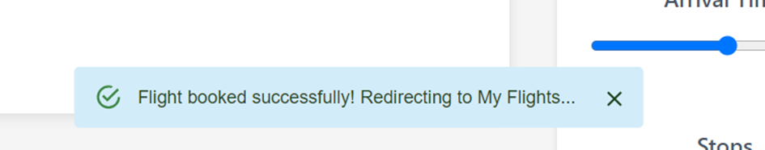
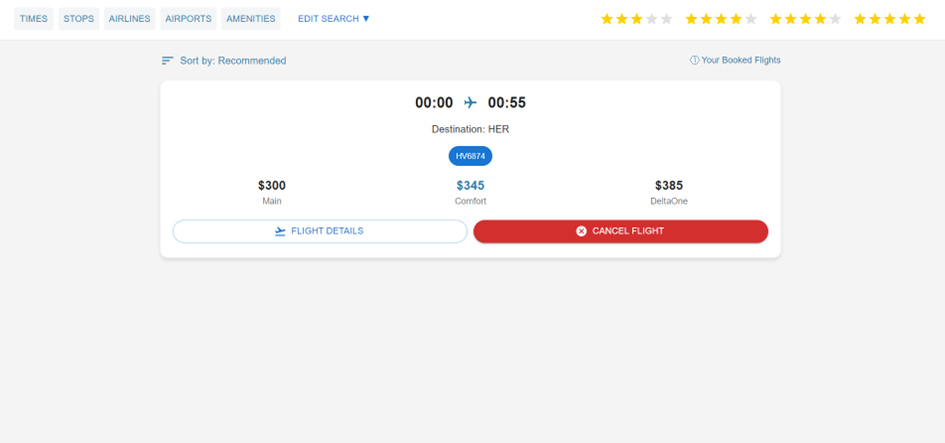
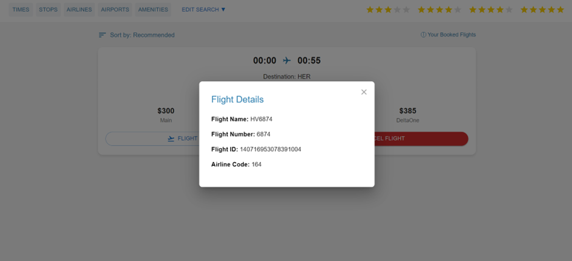
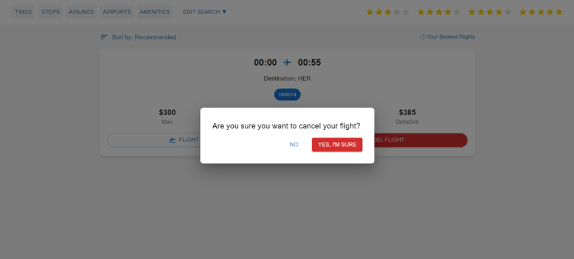
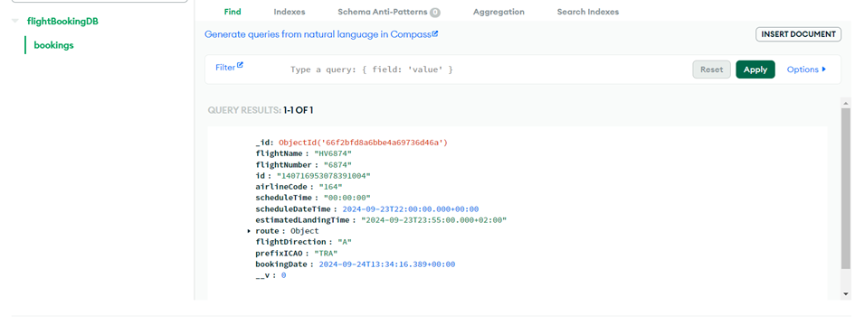

# ✈️ Flight Booking System

A full-stack web application designed for searching, booking, managing, and cancelling flights. The system features a robust backend architecture connected to a MongoDB database and an interactive frontend interface.

---

## 📸 Screenshots

| Search Flights | Flight Booking |
| :---: | :---: |
|  |  |

| My Flights | Flight Details |
| :---: | :---: |
|  |  |

| Flight Cancellation | Database Connection |
| :---: | :---: |
|  |  |

---

## 🛠️ Tech Stack
* **Frontend:** JavaScript, HTML, CSS
* **Backend:** Node.js, Express.js
* **Database:** MongoDB

---

## 🚀 Getting Started & Local Deployment

To run this project locally, follow these steps:

1. **Clone the Repository:**
   ```bash
   git clone [https://github.com/BerivanAyaz/Flight-Booking-System.git](https://github.com/BerivanAyaz/Flight-Booking-System.git)
   ```
2. **Install Dependencies:**
  ```bash
  npm install
  ```
3. **Start the Backend Server & Database Connection:**
   ```bash
   npm run start-server
   ```
4. **Run the Application Locally:**
   ```bash
   npm start
   ```
